# CTFLY UML class diagram

This class diagram follows the class symbol structure from the supplied Chapter 2 reference: class name and attributes, connected by associations. Domain attributes come from the Supabase schema in `supabase/ctfly.sql`; application classes reflect the Android source. The current app models most cloud records as JSON, so domain class boxes below represent the persistent entities in the schema rather than Kotlin data classes.

```mermaid
classDiagram
    direction TB

    class AppViewModel {
      -data: JSONObject
      -busy: Boolean
      -hasAccount: Boolean
    }

    class ClubGateway {
      <<interface>>
      +signedIn: Boolean
    }

    class CtflyApi {
      -session: JSONObject
      -vault: SessionVault
    }

    class StaffSessionGateway {
      -delegate: ClubGateway
      -session: StaffSession
    }

    class SessionVault {
    }

    class StaffSession {
      +locked: Boolean
      +foreground: Boolean
    }

    class Profile {
      +id: UUID
      +name: String
      +phone: String
      +dob: Date
      +role: String
      +points: Int
      +spent: Int
      +active: Boolean
    }

    class User {
      +id: UUID
      +aud: String
      +role: String
      +email: String
      +emailConfirmedAt: DateTime
      +phone: String
      +phoneConfirmedAt: DateTime
      +confirmedAt: DateTime
      +lastSignInAt: DateTime
      +appMetadata: JSON
      +userMetadata: JSON
      +identities: JSON
      +createdAt: DateTime
      +updatedAt: DateTime
      +isAnonymous: Boolean
    }

    class Staff {
      +id: UUID
      +aud: String
      +role: String
      +email: String
      +emailConfirmedAt: DateTime
      +phone: String
      +phoneConfirmedAt: DateTime
      +confirmedAt: DateTime
      +lastSignInAt: DateTime
      +appMetadata: JSON
      +userMetadata: JSON
      +identities: JSON
      +createdAt: DateTime
      +updatedAt: DateTime
      +isAnonymous: Boolean
    }

    class Resource {
      +id: Long
      +name: String
      +kind: String
      +zone: String
      +capacity: Int
      +rate: Int
      +status: String
    }

    class Booking {
      +id: UUID
      +startsAt: DateTime
      +endsAt: DateTime
      +guests: Int
      +total: Int
      +status: String
      +paid: Boolean
      +token: UUID
    }

    class Category {
      +id: Long
      +name: String
    }

    class Product {
      +id: Long
      +name: String
      +price: Int
      +stock: Int
      +threshold: Int
      +active: Boolean
    }

    class Order {
      +id: UUID
      +total: Int
      +paid: Boolean
      +status: String
      +createdAt: DateTime
    }

    class OrderItem {
      +id: Long
      +name: String
      +quantity: Int
      +price: Int
    }

    class Event {
      +id: Long
      +name: String
      +game: String
      +startsAt: DateTime
      +endsAt: DateTime
      +fee: Int
      +capacity: Int
      +status: String
    }

    class Registration {
      +id: UUID
      +team: String
      +fee: Int
      +paid: Boolean
      +status: String
    }

    class Match {
      +id: Long
      +round: Int
      +slot: Int
      +done: Boolean
    }

    class Bill {
      +id: UUID
      +kind: String
      +sourceId: UUID
      +subtotal: Int
      +discount: Int
      +total: Int
      +points: Int
      +method: String
      +status: String
    }

    class TestPayment {
      +id: UUID
      +kind: String
      +sourceId: UUID
      +method: String
      +subtotal: Int
      +discount: Int
      +total: Int
      +status: String
      +expiresAt: DateTime
    }

    class Promotion {
      +id: UUID
      +code: String
      +scope: String
      +benefit: String
      +amount: Int
      +startsAt: DateTime
      +endsAt: DateTime
      +usageLimit: Int
      +active: Boolean
    }

    class Shift {
      +id: UUID
      +startsAt: DateTime
      +endsAt: DateTime
      +status: String
    }

    class Attendance {
      +id: UUID
      +clockIn: DateTime
      +clockOut: DateTime
      +lateMinutes: Int
      +earlyMinutes: Int
      +minutes: Int
    }

    class Reward {
      +id: Long
      +name: String
      +points: Int
      +stock: Int
      +active: Boolean
    }

    class Redemption {
      +id: UUID
      +name: String
      +points: Int
      +status: String
      +createdAt: DateTime
    }

    AppViewModel --> StaffSessionGateway : sends requests through
    AppViewModel --> StaffSession : checks staff access
    StaffSessionGateway ..|> ClubGateway : implements guarded gateway
    StaffSessionGateway --> ClubGateway : delegates to
    CtflyApi ..|> ClubGateway : implements
    CtflyApi *-- SessionVault : persists session in

    Profile "1" --> "0..1" User : customer account
    Profile "1" --> "0..1" Staff : staff/admin account
    Profile "1" --> "0..*" Booking : makes
    Resource "1" --> "0..*" Booking : is reserved by
    Profile "1" --> "0..*" Order : places
    Booking "0..1" <-- "0..*" Order : linked booking
    Category "1" --> "0..*" Product : groups
    Order "1" *-- "1..*" OrderItem : contains
    Product "1" --> "0..*" OrderItem : appears in
    Profile "1" --> "0..*" Registration : signs up
    Event "1" --> "0..*" Registration : has
    Event "1" *-- "0..*" Match : schedules
    Registration "0..*" --> "0..*" Match : competes in
    Profile "1" --> "0..*" Bill : receives
    Profile "1" --> "0..*" TestPayment : pays
    Promotion "0..1" --> "0..*" TestPayment : discounts
    Profile "1" --> "0..*" Shift : works
    Shift "1" *-- "0..1" Attendance : records
    Profile "1" --> "0..*" Redemption : requests
    Reward "1" --> "0..*" Redemption : redeemed as
```

## Relationship notes

- `*--` marks composition: order items belong to an order, attendance belongs to a shift, and matches belong to an event.
- `1`, `0..1`, `0..*`, and `1..*` show the relationship multiplicity.
- `TestPayment` is named after the actual `test_payments` table; the repository configures it for simulation/test checkout.
- `Bill.sourceId` and `TestPayment.sourceId` are polymorphic references in the schema, so their links to bookings, orders, and registrations are represented by `kind` and `sourceId` rather than a direct database foreign key.
- The diagram shows attributes and relationships only; application actions are intentionally omitted.
